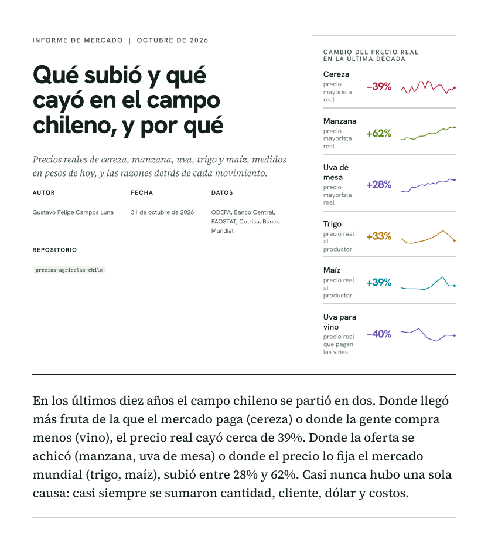

# Precios agrícolas de Chile, 1994 a 2026

[](https://github.com/Gustavo-Campos-Luna/precios-agricolas-chile/actions/workflows/ci.yml)


Datos abiertos, código reproducible e informe de mercado sobre cómo han cambiado, **en pesos reales**, los precios de las principales materias primas agrícolas de Chile (cereza, uva, manzana, trigo, maíz y arroz) y qué explica esos cambios.



**Lea el informe:** [HTML](report/dist/informe_precios_agricolas_chile.html) (un solo archivo, funciona sin conexión) o [PDF](report/dist/informe_precios_agricolas_chile.pdf), 43 páginas, 21 figuras y 50 referencias en formato APA 7.

## Qué responde

> Descontada la inflación, ¿cuánto vale hoy lo que produce el campo chileno frente a hace diez años, y qué pudo mover esos precios?

| Producto | Cambio del precio real | Nivel de mercado |
|---|---:|---|
| Cereza | −39% | Mayorista |
| Uva para vino | −40% | Productor |
| Poroto verde | +12% | Mayorista |
| Uva de mesa | +28% | Mayorista |
| Arroz | +29% | Productor |
| Trigo | +33% | Productor |
| Maíz | +39% | Productor |
| Manzana | +62% | Mayorista |

Precios en pesos de septiembre de 2026; compara promedios de tres temporadas al inicio de la década pasada con tres recientes (períodos exactos en el informe).

### Hallazgos principales

1. **Cereza:** más fruta que mercado y casi todo hacia un cliente (91% a China). El valor de exportación por temporada se movió entre USD 5,1 y 7,7 por kilo de 2009 a 2023 y cayó a USD 4,55 en 2024/25; el flete a Hong Kong pasó de 49% a 102% del retorno al productor.
2. **Manzana y uva de mesa:** menos oferta, mejor precio. La producción de manzana bajó 24% y el precio real subió 62%; la superficie de uva de mesa llegó a su mínimo desde 1999.
3. **Trigo y maíz:** el precio internacional del trigo casi se duplicó en dólares, pero al productor chileno le llegó 33% más en pesos reales. El margen local frente al trigo de EE.UU. bajó de 1,25 a 0,91, coherente con más trigo argentino importado y con las rebajas arancelarias.
4. **Uva para vino:** crisis de demanda con inventario alto. El piso fue 2024; la vendimia 2026 fue 13% mayor.
5. **Lo que no se pudo medir:** el efecto del clima sobre el rendimiento (los datos disponibles no son concluyentes) y el ingreso semanal de fruta a packing (no es público).

Las cifras no son una recomendación de siembra ni de inversión. Los escenarios del informe son condicionales, no pronósticos.

## ¿Dónde están los datos?

El repositorio versiona el **código**, los **resultados de cada figura** y unos pocos datos curados pequeños. Los datos descargados (unos 2,8 GB) se generan localmente y no se suben: así cualquiera puede auditar cada número sin descargar nada, o reconstruir todo desde las fuentes oficiales.

| Qué | Dónde | ¿En Git? |
|---|---|---|
| Tabla de cada figura del informe | [`report/data/*.csv`](report/data) | Sí |
| Informe HTML y PDF | [`report/dist/`](report/dist) | Sí |
| Informes de análisis por producto | [`data/analysis/reports/*.md`](data/analysis/reports) | Sí |
| Superficie, producción y rendimiento de cultivos (FAOSTAT) | [`data/processed/faostat/`](data/processed/faostat) | Sí (1 MB) |
| Clima diario de Talca, Rancagua y Chillán (NASA POWER) | [`data/processed/climate/`](data/processed/climate) | Sí (3 MB) |
| Originales descargados, con hash y manifiesto | `data/raw/` | No (reconstruible) |
| Series normalizadas | resto de `data/processed/` | No (reconstruible) |
| Panel mensual y tablas analíticas | `data/curated/`, `data/analysis/*.parquet` | No (reconstruible) |
| Muestra histórica de la primera carga | [`data/snapshots/`](data/snapshots) | Sí |

La descripción completa de cada carpeta está en [`data/README.md`](data/README.md) y la de cada tabla analítica en [`docs/analysis_layer.md`](docs/analysis_layer.md).

## Inicio rápido

```bash
git clone https://github.com/Gustavo-Campos-Luna/precios-agricolas-chile.git
cd precios-agricolas-chile
python -m venv .venv && source .venv/bin/activate     # en Windows: .venv\Scripts\activate
pip install -e ".[dev,parquet,grains,excel]"

make test          # pruebas offline (no requieren datos descargados)
make data          # descarga y construye todos los datos (varias horas la primera vez)
make report        # genera el informe HTML y el PDF
```

Para el Banco Central (IPC y dólar) se necesita una cuenta gratuita de su base de datos estadísticos; las credenciales van en un archivo `.env` (ignorado por Git):

```
BCCH_USER=su_correo
BCCH_PASSWORD=su_clave
```

Para solo revisar el informe no hace falta instalar nada: abra el HTML o el PDF.

## Estructura

```
src/materias_primas_chile/   código: descarga, limpieza, unidades, variedades, panel y análisis (CLI: mpchile)
scripts/                     análisis por producto (cereza, frutas, cereales, vino)
report/                      informe: cifras, gráficos SVG, textos, referencias APA y salidas
config/                      tablas explícitas: especies y productos, alias de variedades
docs/                        fuentes, contratos de datos, capa analítica, guía de redacción y decisiones
tests/                       pruebas offline de contratos, conversiones, análisis e informe
data/                        datos (ver arriba)
.github/workflows/           integración continua y procesos de datos
```

Flujo de datos: `ingest` (originales con hash) → `build` (series normalizadas) → `volume`, `macro`, `panel` (precio real y kilos) → `supply`, `datasets` (oferta y comercio) → `analysis` (por producto) → `report` (informe). El detalle está en [`docs/architecture.md`](docs/architecture.md) y [`docs/runbook.md`](docs/runbook.md).

## Fuentes

| Fuente | Qué aporta | Licencia |
|---|---|---|
| ODEPA, datos abiertos | Precios mayoristas diarios, comercio exterior, uva para vinificación, consumidor, catastro frutícola | CC BY |
| Banco Central de Chile | IPC general (1928 a 2026), dólar observado | Condiciones de uso del Banco Central |
| FAOSTAT, vía Humanitarian Data Exchange | Precio al productor; superficie, producción y rendimiento de cultivos | CC BY-IGO |
| Cotrisa | Precio de compra de trigo, maíz, arroz y avena | Página pública |
| Banco Mundial, Pink Sheet | Precios internacionales de granos y fertilizantes | Condiciones del Banco Mundial |
| NASA POWER | Clima diario (reanálisis) para el análisis exploratorio | Datos abiertos de la NASA |

Más detalle, cobertura y quiebres conocidos en [`docs/sources.md`](docs/sources.md).

## Principios de calidad

- Se conservan los originales, la URL, la fecha de captura y el checksum de cada archivo.
- Variedad, calidad, origen, unidad y moneda se conservan. Un precio por kilo existe solo si la etiqueta del envase declara su peso; nunca se estima.
- Las series estacionales conservan sus faltantes: no se rellenan con ceros ni se interpolan, y los gráficos cortan la línea donde faltan datos.
- Los precios se comparan en pesos reales y se verifica que el cambio no sea solo un cambio de mezcla.
- Las explicaciones separan hecho, asociación y causa, y declaran su grado de certeza. Los resultados débiles se rotulan como tales.
- Cada cifra externa citada en el informe se verificó abriendo la fuente; el informe no se construye si una cita no existe o una referencia queda sin citar.

Las reglas completas están en [`AGENTS.md`](AGENTS.md); la guía de redacción del informe, en [`docs/guia_de_redaccion_informes.md`](docs/guia_de_redaccion_informes.md).

## Limitaciones principales

El mayorista cubre nueve regiones; la unidad del volumen de ODEPA es inferida; el catastro frutícola mide regiones distintas cada año; la serie chilena de FAOSTAT cambia de base antes de 2015; los costos de la cereza provienen de estimaciones del sector; y las explicaciones propuestas son consistentes con los datos, no pruebas de causa. La lista completa está en el apartado *Límites* del informe.

## Uso de inteligencia artificial

El procesamiento de datos, el código y la redacción se hicieron con asistencia de Claude (Anthropic). Las cifras provienen de las fuentes citadas, el código permite verificarlas y las fuentes de prensa e informes se abrieron y leyeron por separado antes de citarse.

## Cómo citar

Ver [`CITATION.cff`](CITATION.cff) (GitHub ofrece el botón *Cite this repository*). Para el informe:

> Campos Luna, G. F. (2026). *Qué subió y qué cayó en el campo chileno, y por qué* [Informe de mercado]. https://github.com/Gustavo-Campos-Luna/precios-agricolas-chile

## Contribuir

Ver [`CONTRIBUTING.md`](CONTRIBUTING.md). Para cambios en el informe, agregue la fuente en `report/referencias.py` y verifique cada cifra en la página original.

## Licencia

El código se publica bajo licencia MIT ([`LICENSE`](LICENSE)). Los datos de terceros conservan las licencias de sus fuentes.
